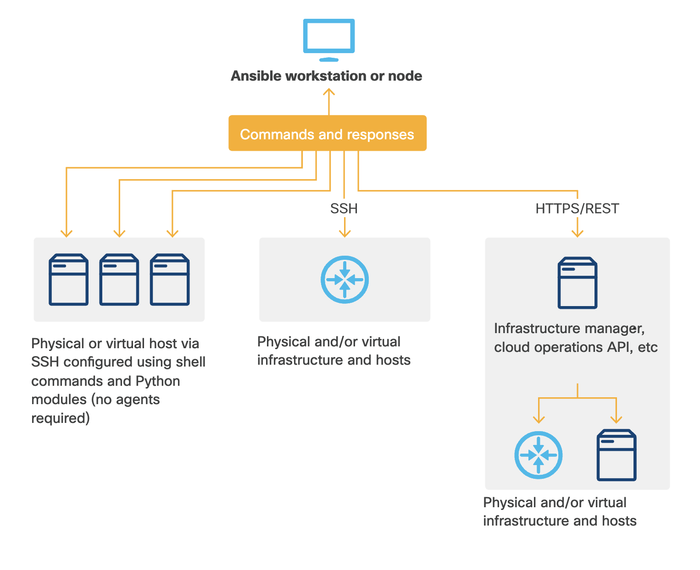

---
title:Ansible
author: cotes 
categories: [cisco virtual cloud,2025-05-26-cisco]
tags: [Network,DevNet]


---

### **7.4.5 Ansible 개요**  

#### **1. 기본 정보**  
- **인기**: 현재 가장 널리 사용되는 오픈소스 자동화 도구  
- **제공 형태**:  
  - **오픈소스 버전**: 무료  
  - **엔터프라이즈 버전**: IBM/Red Hat의 **Ansible Tower** (추가 기능 제공)  
- **이름 유래**:  
  - SF 작가 Ursula K. LeGuin의 소설에서 영감 ("**Ansible**" = 초광속 통신 기술)  

---

#### **2. 아키텍처 및 동작 방식**  
- **경량 설계**: 간단하고 가벼운 구조  
- **컨트롤 노드(Control Node)**:  
  - **요구 사항**: Python 2/3이 설치된 Linux (랩탑, VM, 클라우드 인스턴스 등)  
  - **역할**: 모든 시스템 업데이트 및 작업 관리  
- **관리 대상(Managed Nodes)과 통신**:  
  - **SSH**를 통해 연결 (에이전트 **불필요**)  
  - **기능**:  
    - 원격 서버에서 셸 명령 실행  
    - 라우터/네트워크 장비의 **REST API** 연동  
    - 대상 시스템에 Python 스크립트 임시 주입 및 실행 후 제거  
    - 필요 시 대상 머신에 Python 자동 설치  
  - **플러그인**:  
    - Python을 실행할 수 없는 인프라(클라우드 REST API 등)도 지원  

---

#### **3. 개발 및 운영**  
- **작업 방식**:  
  - **Bash 커맨드라인**에서 주로 관리  
  - 코드 작성: 일반 텍스트 편집기 활용 (예: **Atom** → 디렉토리 구조 편리한 관리)  
- **장점**:  
  - 에이전트 없는 **Agentless 아키텍처** → 배포 및 유지보수 용이  
  - **YAML** 기반 플레이북 → 가독성 높은 자동화 코드 작성  

---

#### **4. 주요 활용 분야**  
- **네트워크 자동화**: Cisco, Juniper 등 장비 구성 관리  
- **클라우드 오케스트레이션**: AWS, Azure, GCP 리소스 배포  
- **서버 프로비저닝**: 대규모 인프라 설정 일괄 적용  

> **핵심**: Ansible은 **단순성**, **확장성**, **에이전트 없는 설계**로 다양한 환경에서 효율적인 자동화를 구현합니다.

------

------

### **7.4.6 Ansible 실습 예제**  


**간단한 웹서버 배포 플레이북 만들기**

---

#### **1. 실습 개요**  
- **목적**: Ansible 플레이북 구조 이해 및 웹서버(Apache) 자동 배포  
- **특이사항**:  
  - 일반적으로 SSH로 원격 호스트와 통신하지만, 이 예제에서는 `connection: local`로 로컬 실행  
  - 실제 환경에 적용 시 **SSH 키 기반 인증** 필요  

---

#### **2. 준비사항**  
- **필요 환경**:  
  - **타겟 호스트**: Ubuntu 18.04 서버 (VirtualBox 등으로 생성 가능)  
  - **SSH 설정**: 키 기반 인증 구성  
  - **로컬 워크스테이션**: Ansible 설치  
- **프로젝트 구조 생성**:  
  ```bash
  mkdir myproject
  cd myproject
  touch inventory site.yml
  mkdir -p roles/webservers/{tasks,files}
  ```

---

#### **3. 인벤토리 파일 설정**  
- **`inventory` 파일**:  
  ```ini
  [webservers]
  target  # 또는 IP 주소 (예: 192.168.1.33)
  ```
  - 그룹(`webservers`)에 타겟 호스트 추가  
  - 복수 호스트 예시:  
    ```ini
    [webservers]
    target1
    target2
    [dbservers]
    target3
    ```

---

#### **4. 플레이북 작성**  
- **최상위 `site.yml`**:  
  ```yaml
  ---
  - hosts: webservers
    become: true  # sudo 권한 사용
    roles:
      - webservers
  ```
  - `hosts: all`로 모든 호스트에 적용 가능  

---

#### **5. 역할(Role) 정의**  
- **`roles/webservers/tasks/main.yml`**:  
  ```yaml
  ---
  - name: Install Apache2
    apt:
      name: apache2
      state: present
      update_cache: yes
  
  - name: Deploy index.html
    copy:
      src: index.html
      dest: /var/www/html/
      owner: myname
      mode: '0444'
  ```
  - **기능**:  
    1. Apache2 설치 (`apt` 모듈)  
    2. 사용자 정의 `index.html` 배포 (`copy` 모듈)  

- **`roles/webservers/files/index.html`**:  
  ```html
  <html>
  <head><title>My Website</title></head>
  <body><h1>Hello!</h1></body>
  </html>
  ```

---

#### **6. 플레이북 실행**  
```bash
ansible-playbook -i inventory -u myname -K site.yml
```
- **옵션 설명**:  
  - `-i`: 인벤토리 파일 지정  
  - `-u`: SSH 사용자명  
  - `-K`: sudo 비밀번호 입력 요청  

- **실행 결과 예시**:  
  ```plaintext
  PLAY [webservers] *******************************************
  TASK [Gathering Facts] *************************************
  ok: [192.168.1.33]
  TASK [webservers : Install Apache2] ************************
  changed: [192.168.1.33]
  TASK [webservers : Deploy index.html] **********************
  changed: [192.168.1.33]
  PLAY RECAP *************************************************
  192.168.1.33 : ok=3, changed=2, failed=0
  ```
  - **Idempotency(멱등성)**: 재실행 시 변경 사항이 없으면 `ok` 상태 유지  

---

#### **7. CI/CD 파이프라인 연동 (예: Jenkins)**  
1. **개발자**가 GitHub에 `index.html` 수정 후 커밋  
2. **테스트 단계**:  
   ```bash
   # 구문 검사 및 테스트
   ansible-playbook main.yml --syntax-check
   ansible-playbook -i staging-servers.cfg main.yml --check
   ```
3. **스테이징 배포**:  
   ```bash
   ansible-playbook -i staging-servers.cfg main.yml -vvvv
   ```
4. **프로덕션 배포**: 테스트 통과 후 동일 플레이북으로 배포  

---

#### **8. 핵심 정리**  
- **장점**:  
  - **간결한 YAML 문법**으로 복잡한 배포 자동화  
  - **에이전트 불필요** (SSH 기반 동작)  
  - **멱등성** 보장 → 안전한 재실행 가능  
- **활용**:  
  - 웹서버 배포, 설정 관리, CI/CD 통합  

> **결과 확인**: 타겟 호스트 IP로 접속 시 "Hello!" 페이지 노출